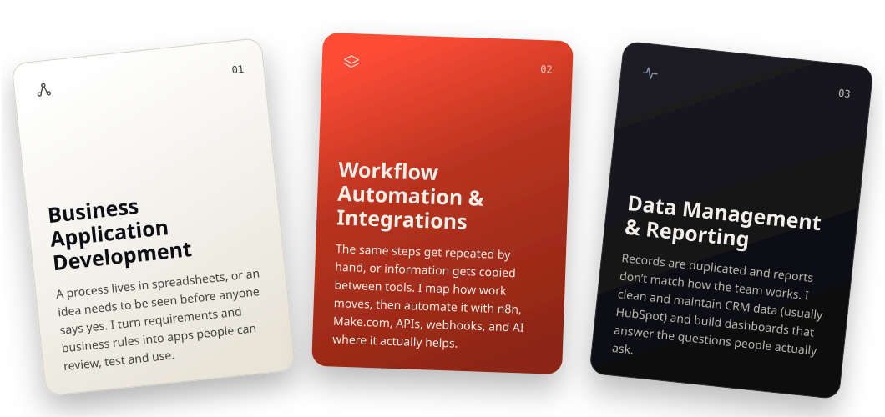

 

<picture>
  <source media="(prefers-color-scheme: dark)" srcset="h-what-i-do-dark.svg" />
  
</picture>

 

<picture>
  <source media="(prefers-color-scheme: dark)" srcset="h-selected-work-dark.svg" />
  
</picture>

 

<picture>
  <source media="(prefers-color-scheme: dark)" srcset="h-toolbox-dark.svg" />
  
</picture>

 

<picture>
  <source media="(prefers-color-scheme: dark)" srcset="h-github-dark.svg" />
  
</picture>

  <picture>
    <source media="(prefers-color-scheme: dark)" srcset="https://github-readme-stats.vercel.app/api?username=emyeeeel&show_icons=true&hide_border=true&include_all_commits=true&bg_color=101014&title_color=D8FF3E&icon_color=D8FF3E&text_color=B9B6AD" />
    
  </picture>
  <picture>
    <source media="(prefers-color-scheme: dark)" srcset="https://github-readme-stats.vercel.app/api/top-langs/?username=emyeeeel&layout=compact&hide_border=true&bg_color=101014&title_color=D8FF3E&text_color=B9B6AD" />
    
  </picture>

 

<picture>
  <source media="(prefers-color-scheme: dark)" srcset="h-contact-dark.svg" />
  
</picture>

Got a process stuck in spreadsheets, steps your team keeps repeating by hand, or CRM data nobody quite trusts? That's the work I take on: business apps, workflow automation, and data & reporting.

<a href="https://linkedin.com/in/emyeeeel"><picture><source media="(prefers-color-scheme: dark)" srcset="btn-linkedin-dark.svg" /></picture></a>
<a href="https://emyeeeel-portfolio.vercel.app/"><picture><source media="(prefers-color-scheme: dark)" srcset="btn-portfolio-dark.svg" /></picture></a>
